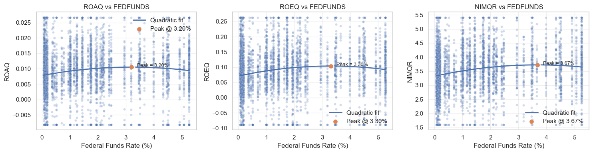
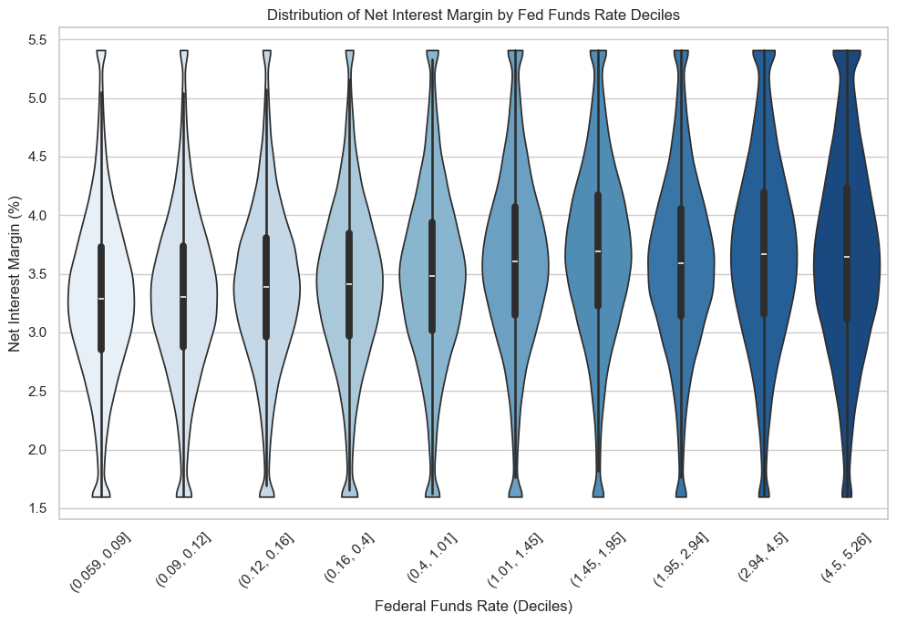

# The Profit Curve: interest rates and U.S. bank profitability, 2001–2023

Is the relationship between the Federal Funds Rate and bank profitability linear? This independent Python project (Data Analytics for Economic Analysis with Python, Esade) tests it on a quarterly bank-level panel of about 640,000 observations, using econometrics for the structure and gradient boosting plus SHAP as a model-free check on the functional form.

## Question

How does the Federal Funds Rate relate to U.S. bank profitability (ROA, ROE, net interest margin), and is the relationship nonlinear?

## Main finding

Profitability is an **inverted-U function of the policy rate**: it rises as rates move up from near zero, peaks at roughly **3.2–3.7%**, and flattens or declines at higher rates. The result holds for all three profitability measures and across specifications.

| Specification (quadratic in FEDFUNDS) | ROA (ROAQ) | ROE (ROEQ) | NIM (NIMQR) |
|---|---|---|---|
| Pooled OLS | 3.20% | 3.30% | 3.67% |
| Pooled OLS + bank controls, bank-clustered SEs | 3.26% | 3.36% | 3.63% |
| Bank fixed effects + controls, bank-clustered SEs | 3.48% | 3.57% | 3.62% |

The linear and quadratic rate terms are statistically significant in every specification, with the expected signs (positive, then negative).

A gradient boosting model for NIM (time-based split, last 8 quarters held out) reaches a test RMSE of 0.65. Permutation importance ranks the loan ratio first, the policy rate second and the deposit-to-funding ratio third, so bank balance-sheet structure matters at least as much as the rate. SHAP on the policy rate shows a nonlinear pattern consistent with the inverted U.



## Data

- **Bank data:** Kaggle, *U.S. Banks Financial Quarterly Ratios* (2001–2023), quarterly profitability and balance-sheet ratios for roughly 6,000 U.S. banks. Raw file: 651,724 bank-quarter rows after merging.
- **Policy rate:** FRED, [Federal Funds Effective Rate (FEDFUNDS)](https://fred.stlouisfed.org/series/FEDFUNDS), quarterly.
- **Merge:** on reporting quarter (inner join). The first difference of the rate (`FEDFUNDS_CHANGE`) is also built.
- **Variables:** outcomes `ROAQ`, `ROEQ`, `NIMQR`. Controls: equity ratio, net loans ratio, deposit ratio, liabilities ratio and the deposit share of funding.
- **Cleaning:** extreme values are winsorized (clipped) at 1.5×IQR fences, and rows with missing values or duplicates are dropped. Final panel: 639,871 bank-quarter observations.
- The raw data is not in this repo; see [`data/README.md`](data/README.md).

## Methods

1. **EDA:** distributions, correlations, scatterplots with LOWESS lines, and NIM violin plots by rate decile.
2. **Quadratic OLS** (`statsmodels`): pooled, with robust (HC1) and bank-clustered standard errors, with and without controls. The turning point is `-β₁ / (2β₂)`.
3. **Bank fixed-effects panel model** (`linearmodels`), clustered by bank. Quarter fixed effects are not used, because the policy rate is the same for every bank in a quarter and would be absorbed.
4. **Diagnostics:** Breusch–Pagan (heteroskedasticity present, hence robust and clustered SEs), Durbin–Watson (about 1.7), RESET (supports adding the quadratic term).
5. **Lasso** with 5-fold cross-validation for feature selection.
6. **Gradient boosting** (`HistGradientBoostingRegressor`) with permutation importance and SHAP, as a check that does not impose a quadratic shape.



## Caveats

- **Associations, not causal effects.** The policy rate is one time series of about 90 quarters, shared by all banks. It moves together with the business cycle, the 2008 crisis and COVID, so the inverted U may partly reflect those regimes. Standard errors clustered by bank do not capture that common variation, so the very small p-values overstate precision.
- **Most observations sit at low rates.** Rates are near zero for a large share of the sample, so the curve beyond about 4% rests on relatively few quarters.
- **The SHAP rate plot rests on few distinct values.** The test set is the last 8 quarters, so the dependence plot has only a handful of distinct rate values (2022–23).
- **The effect is modest relative to differences between banks.** The fitted curve is flat compared with the spread across banks, and the boosting model explains NIM mainly through bank structure.
- Two-way (bank and time) fixed effects cannot identify the rate effect. Notebook 02 keeps the output for documentation; it is numerical noise, as explained there.

## Repo structure

```
├── README.md
├── requirements.txt
├── data/                          # download instructions only
├── notebooks/
│   ├── 01_clean_merge.ipynb       # merge, controls, winsorizing, export
│   ├── 02_eda_regression.ipynb    # EDA, quadratic OLS, panel FE, diagnostics, Lasso
│   └── 03_gradient_boosting_shap.ipynb
├── figures/                       # charts exported from the notebooks
└── docs/The_Profit_Curve_slides.pdf
```

## Reproduce

```bash
pip install -r requirements.txt
# place total_bank_data.csv and FEDFUNDS.csv in data/ (see data/README.md), then run notebooks 01 → 03
```

Notebook 03 uses SHAP's exact explainer on 4,000 test rows and takes several minutes.

## Author

Karan Baylav · [LinkedIn](https://www.linkedin.com/in/karan-baylav)
